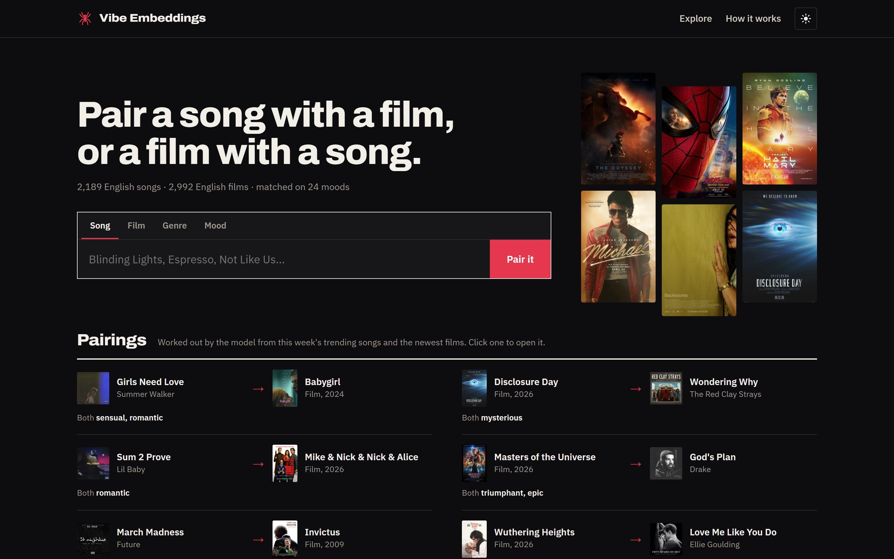
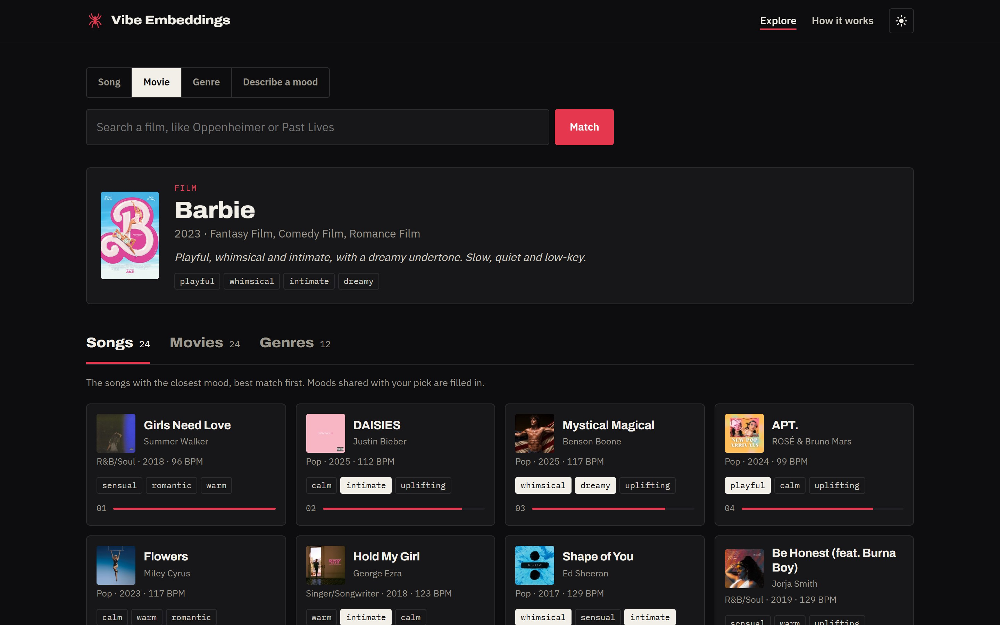
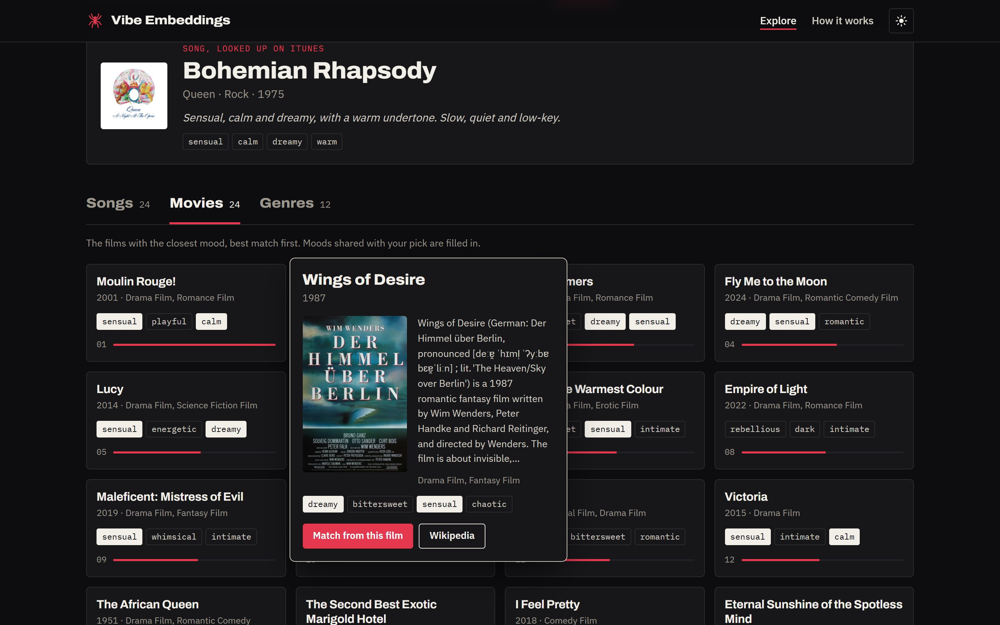
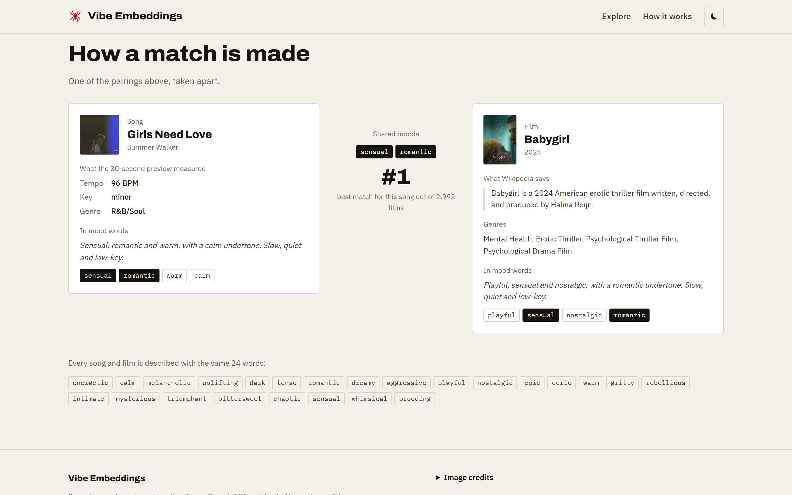
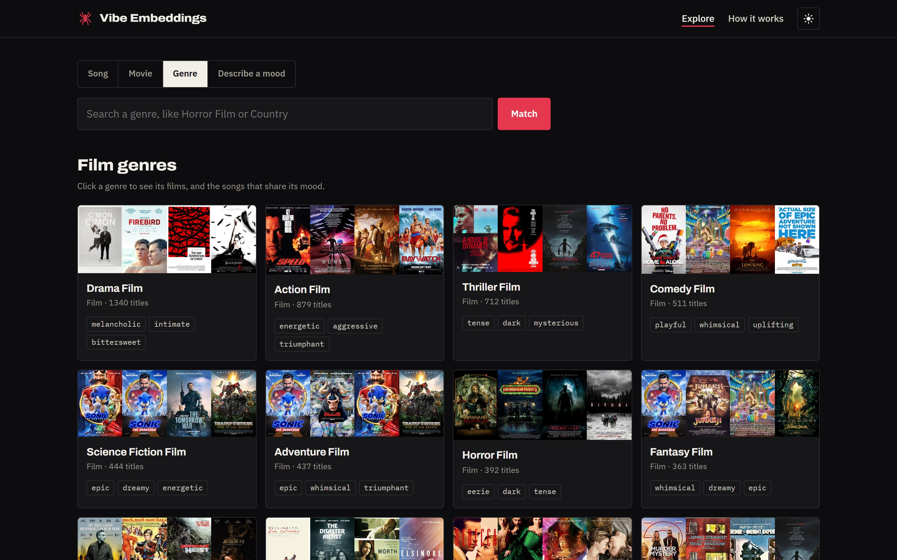
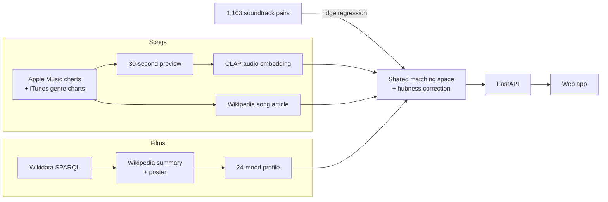

# Vibe Embeddings

**Find the films that feel like a song, and the songs that feel like a film.**

A cross-modal recommendation engine that matches music and movies by mood instead of genre labels. Give it a song and get films with the same feel, give it a film and get songs, browse by genre, or just describe a moment ("rainy late-night drive through the city").




## At a glance

- **What it does:** recommends across two very different domains, songs and films, in both directions, plus genre browsing and free-text mood search, in a hand-built web app.
- **Data:** 2,189 English songs from current English-language charts and 2,992 English films (60% released since 2015), collected entirely from free public sources with no API keys: Apple Music / iTunes, Wikidata and Wikipedia.
- **Model:** a shared song-film matching space that combines a pretrained audio-language model (**CLAP**), a **ridge regression trained on 1,103 soundtrack pairs**, song titles, and what a song's Wikipedia article says it is about, with a **hubness correction** so no single film dominates.
- **Evaluation:** there is no public dataset for "this song feels like this film", so I **built a ground-truth benchmark from official movie soundtracks** (1,107 songs from 310 films). The first version of the model scored no better than random on it; the current one ranks the right match far higher (table below).
- **Engineering:** an end-to-end pipeline (data collection, feature extraction, embeddings, evaluation, API, frontend), resumable and incremental, packaged as one Docker image.

## Results

Measured on the soundtrack benchmark: for each soundtrack song, where does its own film rank among all 2,992 films, and where do a film's own soundtrack songs rank among ~3,100 songs? Lower is better; **random guessing scores 50%**.

| Model | Song → film<br>(mean percentile) | Film → song<br>(mean percentile) | Film → song<br>(own soundtrack in top 5%) |
|---|---|---|---|
| First version (mood-sentence embeddings) | 48.5% (random) | 49.9% (random) | 4.7% |
| Current, sung songs | **29.3%** | **24.8%** | **21.3%** |
| Current, songs with a Wikipedia article | **22.3%** | **15.9%** | **52.1%** (chance: 5%) |

Some real outputs from the current model:

| Start from | Top matches |
|---|---|
| *Barbie* (2023) | APT. (ROSÉ & Bruno Mars) · Flowers (Miley Cyrus) · Mystical Magical (Benson Boone) |
| *The Notebook* (2004) | Someone You Loved (Lewis Capaldi) · I'll Never Love Again (Lady Gaga) |
| *Interstellar* (2014) | Something In The Heavens (Lewis Capaldi) · A Sky Full of Stars · The Night We Met |
| Bohemian Rhapsody (Queen) | *Moulin Rouge!* · *Wings of Desire* · *The Dreamers* |
| BIRDS OF A FEATHER (Billie Eilish) | *Eternal Sunshine of the Spotless Mind* · *Sleepless in Seattle* · *Easy A* |

## Screenshots

<table>
  <tr>
    <td width="50%"><br><sub><b>Film → songs.</b> Results in three tabs, moods shared with the query filled in.</sub></td>
    <td width="50%"><br><sub><b>Hover a film</b> for its poster, plot and moods. Songs not in the catalog are looked up live.</sub></td>
  </tr>
  <tr>
    <td width="50%"><br><sub><b>How a match is made:</b> one pairing taken apart, in light mode.</sub></td>
    <td width="50%"><br><sub><b>Genre browsing:</b> clicking a genre shows its films or songs, plus the closest matches from the other side.</sub></td>
  </tr>
</table>

## How it works



**The problem.** A song is audio and a film is a story; they share no features. Embedding them directly mostly teaches a model "this is a song" vs. "this is a film".

**The common language.** Every film and song is described with the same 24 mood words ([`src/moods.py`](src/moods.py)), shown on every card so the reason for a match is visible. Films are scored by zero-shot similarity between their Wikipedia summary and an anchor sentence per mood, plus a prior from their genres.

**The matching space** ([`src/cross_space.py`](src/cross_space.py)) adds up four signals, each kept only because it improved the benchmark:

1. **CLAP** ([LAION's clap-htsat-unfused](https://huggingface.co/laion/clap-htsat-unfused)), a contrastive model that places audio and text in one space. A song's audio is compared directly with a caption for each film, such as *"dark, tense, mysterious music from the soundtrack of a horror film"*.
2. **A learned map** from CLAP audio into the film-mood space: a ridge regression trained on (soundtrack song, its film) pairs, evaluated only on films it never saw.
3. **The song title**, read for mood.
4. **The song's Wikipedia article** (499 songs). Audio alone can't tell that a bouncy track is a breakup song; the article can, and it is scored exactly like a film summary, so it lands in the same space.

Two corrections make the results useful, not just good on paper:

- **Hubness correction.** In shared embedding spaces a few items sit close to everything. Before the fix, one comedy (*Blockers*) was in the top five films for **684 of 2,189 songs**. Subtracting each item's average score over the other side spread recommendations across **1,502 different films** instead of 958, for a cost of 1-3 points on the benchmark.
- **Sung songs first.** The soundtrack ground truth is mostly orchestral score, so a model tuned only on it answered every film with piano and strings. CLAP separates sung from instrumental tracks reliably, and sung tracks get a nudge, because people asking "what songs feel like *Barbie*" want songs.

Same-domain recommendations use the best signal for each side: how alike two songs *sound* (CLAP audio) blended with mood, and plot similarity blended with mood for films.

## Evaluation

**1. Soundtrack benchmark** ([`src/cross_eval.py`](src/cross_eval.py), [`src/soundtrack_benchmark.py`](src/soundtrack_benchmark.py)). A film's soundtrack was chosen or written to fit it, which makes it a fair proxy for "feels the same".

- Soundtrack albums are matched strictly (the album title must be the film's, and remix / lo-fi / tribute albums are rejected), giving 1,107 songs from 310 films.
- Tracks whose title names their film (e.g. "Oppenheimer") are dropped, so nothing can win by matching names: 919 songs from 272 films remain.
- The learned map is re-fit per fold (grouped by film), so every test film is unseen.
- Results are reported separately for sung songs and songs with an article, since those are what users actually search for (table above). Weights were tuned on the same benchmark, so the numbers are somewhat optimistic.

**2. Intrinsic check** ([`src/evaluate.py`](src/evaluate.py)). Same-domain neighbours should share a genre with the query more often than random items: songs **4.4×** above random (26.2% vs 6.0%), films **2.3×** (55.4% vs 24.6%).

**3. Human survey** ([`survey/app.py`](survey/app.py)). A Streamlit app shows a song or film plus three candidates from the other side (the model's top pick, a middle one and a bottom one, shuffled) and records which one people pick. The analysis tests the top-pick rate against the 33% chance rate with a binomial test. Built and ready; responses still to be collected.

## Engineering decisions and lessons

- **Measure before trusting.** The first cross-domain model produced plausible-looking results and was no better than random once measured. Everything in the current matching space is there because it moved the benchmark.
- **Verify pretrained models in your own stack.** `laion/larger_clap_music` loads without errors in transformers 5, but its audio and text towers come out unaligned (every audio-text similarity ≈ 0). I caught it with a five-song sanity test and switched to a checkpoint that passes it.
- **Data source pivots.** Spotify deprecated its audio-features API for new apps, so audio is analysed directly from previews. TMDB's terms prohibit ML use, so film data comes from Wikidata (CC0).
- **Rank popularity within each release year.** Ranking films by Wikipedia coverage favours old classics (only 7% of a first catalog was from 2020+). Ranking within each year keeps the catalog current.
- **Look up articles by ID, not by name.** Fetching Wikipedia by film title silently returned the country for *Brazil* (1985) and the monster for *Godzilla* (1998). Articles now come from each film's exact Wikidata sitelink.
- **Watch for skew from a single source.** One Christian & Gospel chart made up 12% of the song catalog and surfaced for every epic film; the New Age chart was mostly white noise and sleep sounds. Both were filtered out.
- **Language without a language field.** iTunes has no language metadata, so English-only is enforced by storefront, genre labels, script and title markers, tested against known edge cases (e.g. keeping "Die With A Smile", dropping "Con Calma").
- **Respect rate limits.** Wikipedia returns HTTP 429 on bursts; treating that as "not found" silently dropped films. Requests are batched and back off on `Retry-After`.
- **Fast first requests.** Model loading and librosa's one-time compilation run in a background thread at startup, which cut the first live song lookup in a fresh container from 33 s to about 7 s.

## Tech stack

| Area | Tools |
|---|---|
| Machine learning | PyTorch, Hugging Face Transformers (CLAP), sentence-transformers (all-MiniLM-L6-v2), scikit-learn (ridge regression), NumPy |
| Audio | librosa, ffmpeg |
| Data | pandas, Parquet, SPARQL (Wikidata), MediaWiki API, iTunes Search API, Apple Music RSS |
| Backend | FastAPI, Uvicorn |
| Frontend | Hand-written HTML, CSS and JavaScript (no framework), light and dark themes, responsive |
| Evaluation | scikit-learn GroupKFold, SciPy (binomial test), Streamlit (survey) |
| Packaging | Docker, Docker Compose |

## Run it locally

The catalogs and trained models are committed, so it runs without rebuilding anything.

**With Docker** (needs about 1.5 GB of RAM; the models are built into the image):
```bash
docker compose up --build
```
Then open http://localhost:8000. API docs are at http://localhost:8000/docs.

**With Python** (3.10+, and [ffmpeg](https://www.gyan.dev/ffmpeg/builds/) on your PATH for live song lookups):
```bash
git clone https://github.com/Charan7sai/vibe-embeddings.git
cd vibe-embeddings
python -m venv venv
venv\Scripts\activate          # Windows
# source venv/bin/activate     # macOS / Linux
pip install -r requirements.txt
uvicorn api.main:app
```
The first start downloads the two models (~700 MB) from Hugging Face.

**Rebuilding the data from scratch** (each step is resumable):
```bash
python src/build_catalog.py --songs --movies        # catalogs: songs ~2 h (audio analysis), films ~30 min
python src/soundtrack_benchmark.py --films 450      # ground truth: find soundtrack albums
python src/soundtrack_benchmark.py --features       # ...and analyse their previews
python src/clap_cache.py                            # CLAP embeddings for every preview
python src/song_wiki.py                             # Wikipedia articles for songs
python src/vibe_descriptions.py                     # film and query moods
python src/embed.py                                 # builds models/
python src/fetch_landing.py                         # landing page photos and credits
python src/cross_eval.py --production               # soundtrack benchmark
python src/evaluate.py                              # intrinsic metrics and survey results
```

**API example:**
```bash
curl -X POST localhost:8000/api/recommend -H "content-type: application/json" \
     -d '{"type": "movie", "query": "Interstellar", "target": "song", "k": 5}'
```
`type` is `song | movie | genre | text`, with either a catalog `id` or a `query`; `target` is `song | movie | genre`. Also available: `GET /api/search`, `/api/genres`, `/api/featured`, `/api/pairings`, `/api/health`.

## Project structure

```
vibe-embeddings/
├── src/
│   ├── build_catalog.py         # collects songs and films (resumable, incremental)
│   ├── itunes_client.py         # Apple Music / iTunes charts, lookup, cover art
│   ├── wikidata_client.py       # films via SPARQL, Wikipedia summaries and posters
│   ├── audio_features.py        # librosa features via ffmpeg
│   ├── clap_audio.py            # CLAP audio and text embeddings
│   ├── clap_cache.py            # cached CLAP embeddings for every preview
│   ├── song_wiki.py             # Wikipedia articles for songs
│   ├── moods.py                 # the 24 moods and genre priors
│   ├── vibe_descriptions.py     # text -> mood scores -> mood sentence
│   ├── cross_space.py           # the song <-> film matching space
│   ├── embed.py                 # builds everything in models/
│   ├── recommender.py           # the recommendation engine
│   ├── soundtrack_benchmark.py  # ground truth from movie soundtracks
│   ├── cross_eval.py            # song <-> film benchmark
│   ├── evaluate.py              # intrinsic metrics and survey analysis
│   └── fetch_landing.py         # landing page photos and credits
├── api/main.py                  # FastAPI: /api routes and the site
├── web/                         # frontend: index.html, styles.css, app.js, favicon.svg
├── survey/app.py                # Streamlit survey for human labels
├── models/                      # trained artifacts the app loads
├── data/processed/              # catalogs, soundtrack pairs, song articles, embedding cache
├── docs/screenshots/            # images in this README
└── Dockerfile, docker-compose.yml, requirements.txt
```

## Data sources and licensing

| Data | Source | Notes |
|---|---|---|
| Songs, 30-second previews, cover art | [Apple Music charts](https://rss.applemarketingtools.com), [iTunes Search API](https://performance-partners.apple.com/search-api) | Free, no account needed |
| Films | [Wikidata](https://www.wikidata.org) | CC0 |
| Film summaries, posters, song articles | [Wikipedia](https://en.wikipedia.org) | Text under CC BY-SA; posters are non-free images shown as Wikipedia does |
| Landing page photos | Wikipedia and Wikimedia Commons | Linked rather than copied, and credited in the site footer |
| Models | [CLAP](https://huggingface.co/laion/clap-htsat-unfused), [all-MiniLM-L6-v2](https://huggingface.co/sentence-transformers/all-MiniLM-L6-v2) | Pretrained, open weights |

## Limitations and next steps

- **Song → film is the harder direction for chart pop without a Wikipedia article.** Upbeat production reads as "playful", and comedies use upbeat pop, so such songs can drift towards comedies. Lyrics would help most, but there is no free lyrics source whose terms allow it.
- **The benchmark is soundtrack-shaped**, mostly orchestral score against its film, which is why sung songs and songs with articles are reported separately.
- **Catalogs are snapshots.** The pipeline is incremental, so a scheduled job (e.g. weekly GitHub Actions) could keep it current. Anything outside the catalog is already handled by live lookup.
- **Next steps:** collect survey responses for a human-judged score, add a "last updated" date with scheduled refreshes, and try a lighter static deployment that precomputes recommendations.

## Author

**Charan Sai Neelisetty** · [GitHub](https://github.com/Charan7sai)

## License

MIT
